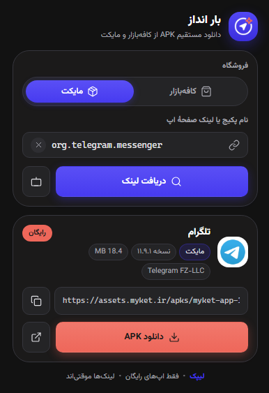
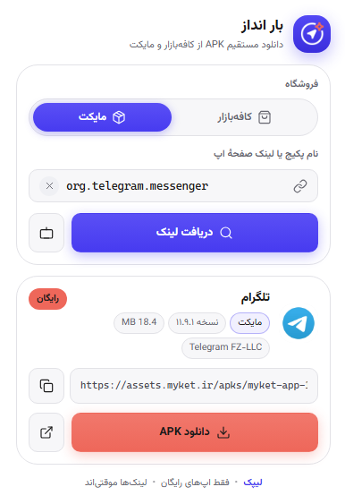

<div dir="rtl">

# بار انداز

**لینک دانلود مستقیم APK برای اپلیکیشن‌های رایگان [کافه‌بازار](https://cafebazaar.ir) و [مایکت](https://myket.ir)**

افزونهٔ کروم (Manifest V3) که بدون نصب اپ استور، لینک دانلود مستقیم فایل APK را
برای اپ‌های رایگان هر دو فروشگاه پیدا می‌کند.

</div>

[](LICENSE)
[](manifest.json)
[](https://github.com/mmehdishafiee/bar-andaz/actions/workflows/ci.yml)
[](CONTRIBUTING.md)

<div dir="rtl">



</div>

<div align="center">

</div>

---

<details>
<summary><b>English summary</b></summary>

**Bar Andaz** (بار انداز) is a Manifest V3 Chrome extension that resolves **direct
APK download links** for **free** Android apps published on the two main Iranian
app stores: [Cafebazaar](https://cafebazaar.ir) and [Myket](https://myket.ir).

It has no build step and no npm dependencies — it is plain JavaScript, and
`node tools/build.js` produces a distributable zip using a built-in ZIP writer.
Everything runs locally: the extension only talks to the two stores' own
servers. See [how it works](#چطور-کار-می-کند) for the API details.

Licensed under the [MIT License](LICENSE).

</details>

---

<div dir="rtl">

## ✨ ویژگی‌ها

- **دو فروشگاه، یک افزونه** — کافه‌بازار و مایکت، با سوییچ خودکار بر اساس آدرس صفحه
- **سه راه استفاده** — پاپ‌آپ، خواندن از تب فعلی، و دکمهٔ شناور روی خود صفحات فروشگاه
- **نام فایل تمیز** — خروجی به‌صورت `packageName.apk` ذخیره می‌شود (مثلاً `ir.tna.apartment.apk`)
- **رابط دوزبانه‌ی راست‌به‌چپ** — با پشتیبانی خودکار از حالت روشن و تیره
- **سبک و بدون وابستگی** — بدون npm، بدون build step، بدون درخواست به سرور شخص ثالث
- **کاملاً متن‌باز** — MIT

## 📦 نصب

### از سورس (حالت توسعه‌دهنده)

۱. مخزن را کلون کن:

```bash
git clone https://github.com/mmehdishafiee/bar-andaz.git
cd bar-andaz
```

۲. کروم را باز کن و به `chrome://extensions` برو.
۳. گوشهٔ بالا-راست **Developer mode** را روشن کن.
۴. **Load unpacked** را بزن و پوشهٔ مخزن را انتخاب کن.

همین. آیکون بار انداز در نوار ابزار ظاهر می‌شود.

### بستهٔ آمادهٔ نصب

```bash
node tools/build.js     # خروجی: dist/bar-andaz-v1.2.0.zip
```

## 🚀 استفاده

سه راه برای گرفتن لینک وجود دارد:

**۱. پاپ‌آپ** — روی آیکون افزونه کلیک کن، فروشگاه را انتخاب کن، نام پکیج
(`com.example.app`) یا لینک صفحهٔ اپ را وارد کن و «دریافت لینک» را بزن.

**۲. از تب فعلی** — اگر روی صفحهٔ یک اپ در یکی از دو سایت باشی، پاپ‌آپ خودش
فروشگاه و نام پکیج را پر می‌کند. دکمهٔ کنار «دریافت لینک» هم همین کار را دستی
انجام می‌دهد.

**۳. دکمهٔ شناور** — روی صفحات `cafebazaar.ir` و `myket.ir` یک دکمهٔ
«دانلود مستقیم APK» پایین-چپ صفحه ظاهر می‌شود که بدون باز کردن پاپ‌آپ لینک را
می‌دهد.

بعد از گرفتن لینک می‌توانی فایل را دانلود کنی، لینک را کپی کنی، یا در تب جدید بازش کنی.

## ⚠️ محدودیت‌ها

- **فقط اپ‌های رایگان.** اپ‌های پولی لینک دانلود مستقیم ندارند.
- **لینک‌های کافه‌بازار موقتی‌اند.** آدرس CDN یک `token` و `expire` دارد؛ بعد از
  انقضا باید لینک را دوباره بسازی. (لینک‌های مایکت توکن انقضا ندارند، اما بهتر
  است همیشه تازه گرفته شوند.)
- **بعضی پکیج‌ها در هر دو فروشگاه نیستند.** اگر اپی در مایکت نباشد، مایکت خطای
  ۴۰۴ می‌دهد و افزونه پیام «پیدا نشد» نشان می‌دهد.
- **ساختار این سایت‌ها می‌تواند عوض شود.** این افزونه یک بار همین‌طور خراب شد؛
  اگر باز هم شد، فقط `shared.js` باید به‌روز شود.

## 🔧 چطور کار می‌کند

هیچ‌کدام از درخواست‌های شبکه از `content script` زده نمی‌شود؛ در Manifest V3
درخواست‌های cross-origin در content script بلاک می‌شوند. پس همهٔ ترافیک از
سرویس‌ورکر می‌گذرد که با `host_permissions` مجاز است.

### کافه‌بازار

| مرحله | جزئیات |
|---|---|
| دانلود | `POST https://api.cafebazaar.ir/rest-v1/process/AppDownloadInfoRequest` |
| بدنه | `{properties: {androidClientInfo: {...}, clientID, clientVersion, …}, singleRequest: {appDownloadInfoRequest: {packageName, deviceId, referrers: []}}}` |
| پاسخ | `singleReply.appDownloadInfoReply.fullPathUrls[0]` — آدرس امضاشدهٔ CDN |
| متادیتا | `POST …/AppDetailsV2Request` برای نام، آیکون و نسخه (اختیاری — هرگز دانلود را بلاک نمی‌کند) |

نکته: فقط همین املا با پسوند `Request` وجود دارد. نام‌هایی مثل `AppDownloadInfo`
یا `AppDownloadRequest` خطای ۴۰۴ می‌دهند. فیلدهای `androidClientInfo` احراز هویت
نمی‌شوند و هر مقدار شبیه دستگاه اندروید قبول است.

### مایکت

مایکت API عمومی JSON ندارد. دو مرحله:

۱. صفحهٔ `https://myket.ir/app/<package>` گرفته و بلوک `<script type="application/ld+json">`
از نوع `SoftwareApplication` از آن بیرون کشیده می‌شود: `name`، `image` (آیکون)،
`description`، و در صورت وجود `softwareVersion`، `fileSize` و `offers.price`
(برای تشخیص رایگان/پولی). چون سرویس‌ورکر MV3 به DOM دسترسی ندارد، این تجزیه با
regex انجام می‌شود، نه `DOMParser`.

۲. لینک دانلود همان آدرسی است که دکمهٔ خود سایت استفاده می‌کند:
`https://myket.ir/dl?packageName=<package>` که با **۳۰۲** به
`https://assets.myket.ir/apks/….apk` می‌رود. برای اینکه فایل کامل دانلود نشود،
درخواست با هدر `Range: bytes=0-0` زده می‌شود، آدرس نهایی از `Response.url`
خوانده و بدنه فوراً `cancel` می‌شود. حجم فایل هم از هدر `Content-Range` می‌آید.

## 🗂 ساختار پروژه

```
bar-andaz/
├── manifest.json          # تعریف MV3، مجوزها، host_permissions
├── shared.js              # هستهٔ خالص: تشخیص فروشگاه، ساخت payload، تجزیهٔ پاسخ
├── background.js          # سرویس‌ورکر؛ تنها جایی که درخواست شبکه زده می‌شود
├── content.js             # دکمهٔ شناور روی صفحات فروشگاه‌ها
├── popup.html/.css/.js    # رابط پاپ‌آپ
├── icons/                 # آیکون‌ها (از لوگوی لیپک ساخته می‌شوند)
├── fonts/                 # وزیرمتن (متغیر) برای تایپوگرافی فارسی
├── assets/                # لوگوی منبع برای بازتولید آیکون‌ها
├── docs/                  # تصاویر مستندات
└── tools/                 # check.js · test_core.js · build.js · make_icons.py
```

## 🛠 توسعه

نیازمندی‌ها: Node.js 18+ (برای ابزارها) و Python + Pillow (فقط برای بازتولید آیکون‌ها).

```bash
npm run check     # بررسی‌های ایستا: manifest، ارجاع فایل‌ها، syntax
npm test          # تست زندهٔ هر دو فروشگاه (به شبکه نیاز دارد)
npm run build     # بررسی + ساخت dist/bar-andaz-v1.2.0.zip
npm run icons     # بازتولید آیکون‌ها از assets/leepaak-logo.webp
```

راهنمای کامل برای مشارکت: [CONTRIBUTING.md](CONTRIBUTING.md)

## 🔒 حریم خصوصی

افزونه هیچ داده‌ای جمع‌آوری، ذخیره یا ارسال نمی‌کند. تنها درخواست‌های شبکه همان‌هایی
هستند که مستقیم به سرور کافه‌بازار و مایکت می‌رود. یک شناسهٔ تصادفی `deviceId`
صرفاً به‌صورت محلی در `chrome.storage.local` ذخیره می‌شود.

جزئیات: [PRIVACY.md](PRIVACY.md)

## 💛 سپاسگزاری

- طراحی و پالت رنگی بر پایهٔ هویت بصری [لیپک](https://leepaak.ir)
- فونت [وزیرمتن](https://github.com/rastikerdar/vazirmatn) ساختهٔ صابر راستی‌کردار (مجوز OFL)
- آیکون‌ها به سبک [Lucide](https://lucide.dev) (مجوز ISC)

مجوزهای کامل اجزای شخص ثالث: [LICENSES.md](LICENSES.md)

## ⚖️ سلب مسئولیت

این پروژه به هیچ‌کدام از کافه‌بازار یا مایکت وابسته نیست و توسط آن‌ها تأیید یا
پشتیبانی نمی‌شود. این ابزار تنها همان کاری را خودکار می‌کند که خودِ وب‌سایت این
فروشگاه‌ها در مرورگر انجام می‌دهد: گرفتن لینک دانلود اپ‌های **رایگان**. لطفاً
شرایط استفادهٔ هر فروشگاه را رعایت کن و فقط اپ‌هایی را دانلود کن که مجاز به
دریافتشان هستی.

## 📄 مجوز

[MIT](LICENSE) © 2026 Leepaak

</div>
